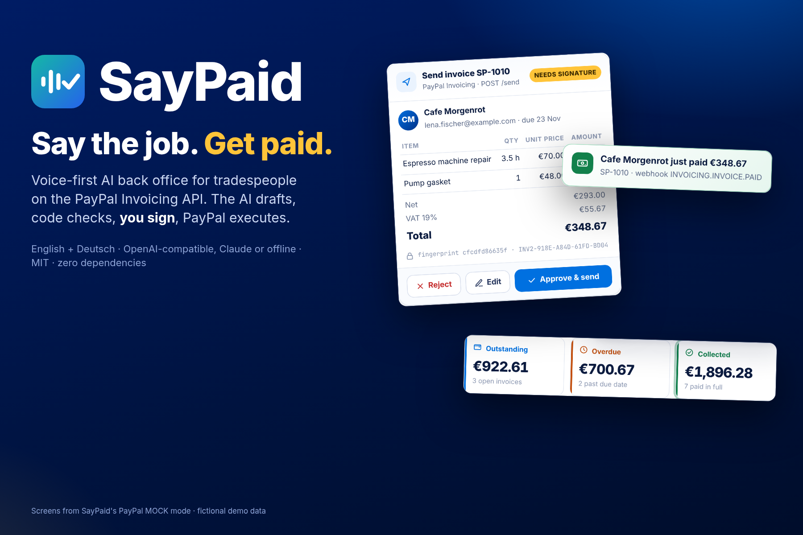
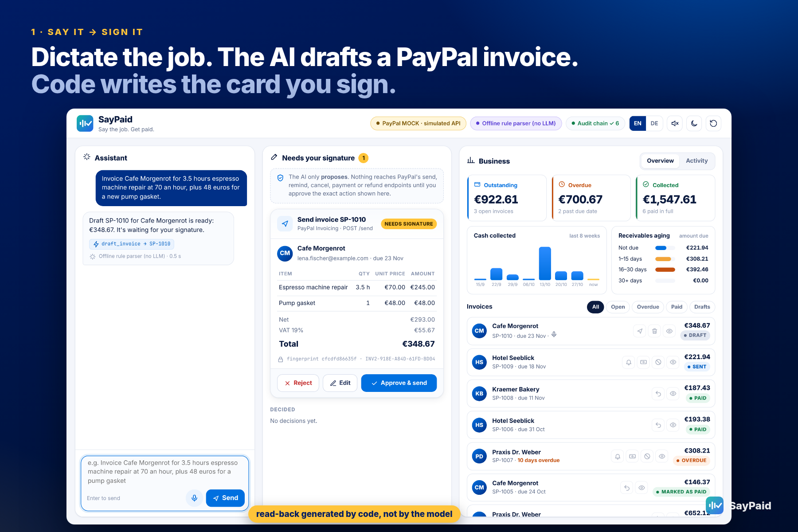
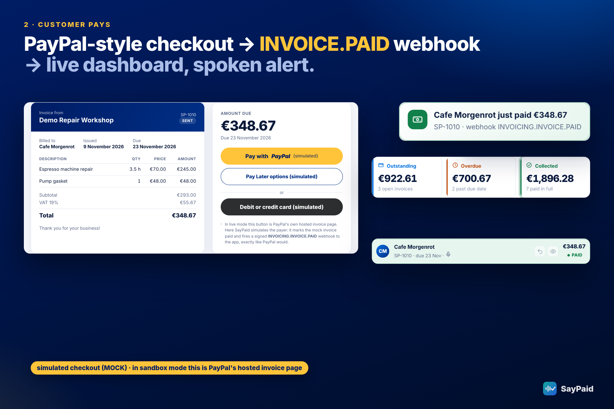
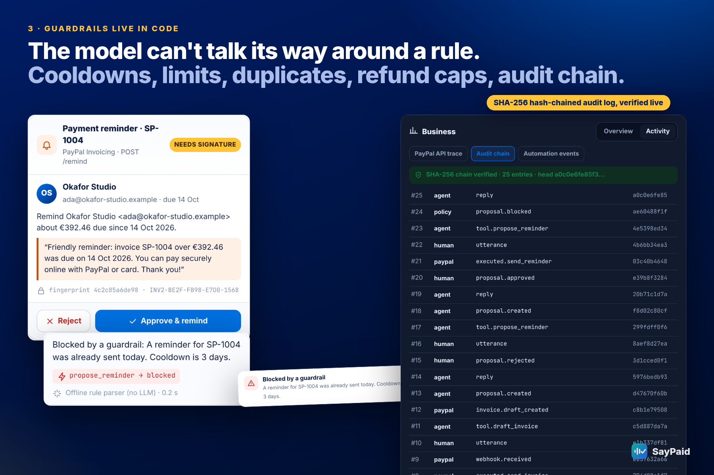
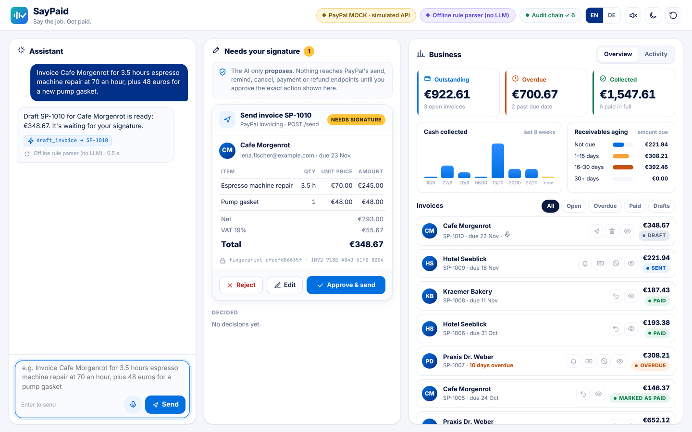
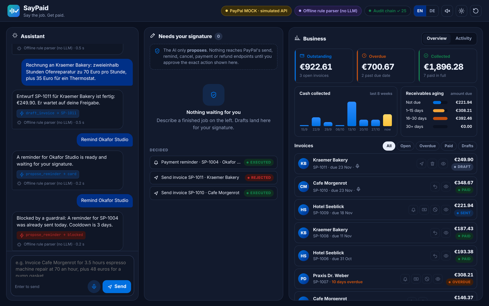
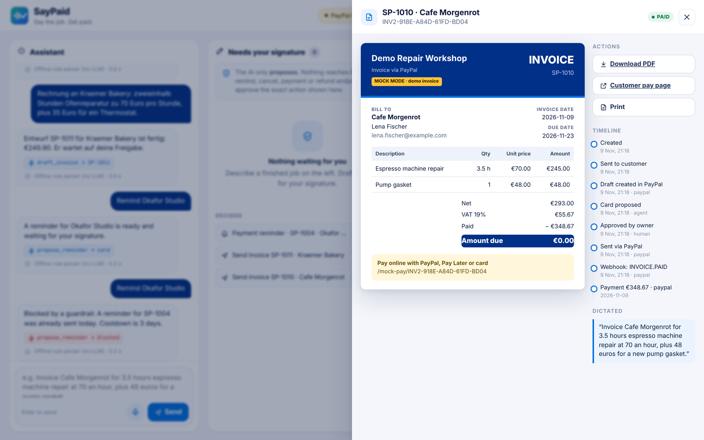
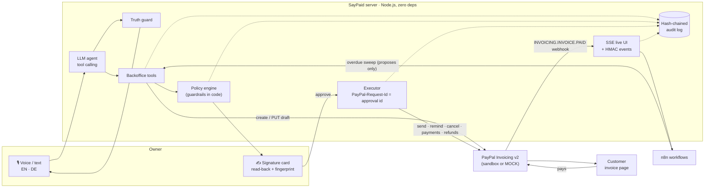

<p align="center"></p>

> 🎬 **Demo video:** https://youtu.be/pgwmLNfwk4w

# SayPaid · say the job, get paid

**A voice-first AI back office for tradespeople, built on the PayPal Invoicing API.**

You describe the job you just finished, in English or German. A tool-calling LLM agent turns it into a **PayPal invoice draft**. Deterministic guardrails check it. **You sign the exact action on a card. Only then does PayPal send it.** When the customer pays, the `INVOICING.INVOICE.PAID` webhook updates the dashboard and SayPaid tells you who just paid.

> **The model proposes. Code checks. A human signs. PayPal executes.**

Built solo for the **PayPal AI Hackathon 2026** (Devpost). MIT licensed. Zero npm dependencies.

▶️ **Demo video:** _link added after upload_

| Voice → signature card | Customer pays (mock checkout) | Guardrails, audit, automation |
|---|---|---|
|  |  |  |

---

## Why

For an electrician, a coffee-machine technician or a handyman, the job ends on site but the paperwork doesn't. Invoices get written days later from memory, line items get lost, and chasing late payers is the job everyone puts off. SayPaid moves invoicing to the moment the work is done: you say it while you pack up the van.

Letting an AI touch money needs trust, so SayPaid never lets the model act on its own. It can only **propose**. Every action that touches money becomes a signature card that is **generated by code from PayPal's own draft**, not by the model.

## Features

| | Feature | How |
|---|---|---|
| 🎙 | **Talk or type the job** | Browser speech recognition (Chrome/Edge) with a live waveform; **English and German**. Replies can be read aloud. |
| 🧠 | **Tool-calling agent** | `draft_invoice`, `revise_draft`, `list_invoices`, `get_summary`, `find_customer`, `propose_reminder`, `propose_record_payment`, `propose_refund`, `propose_cancel`. Runs on any OpenAI-compatible endpoint (OpenAI, local llama.cpp, Ollama…), Anthropic Claude, or a bilingual **offline rule parser** with no model at all. If the model endpoint is down, SayPaid falls back to the offline parser and says so. |
| 🧾 | **Real PayPal Invoicing v2 flow** | `generate-next-invoice-number`, create draft, **PUT** to edit a draft, DELETE to discard, `send`, `remind`, `cancel`, `payments` (cash/bank transfer), `refunds`, and the `INVOICING.INVOICE.PAID` webhook. |
| ✍️ | **Signature cards** | Exact read-back (items, VAT, total, due date, recipient, reminder text), **editable line items** for drafts, and an **action fingerprint** that also covers the items and total. If anything changes after display, approval is refused. |
| 🛡 | **Guardrails in code** | Hard limit (blocked), soft limit (warning), duplicate detection, new-recipient warning, hourly-rate deviation, reminder cooldown, no cancelling paid invoices, no over-recording payments, refunds capped at the paid amount. Policy is re-checked at execution time. |
| 🔁 | **Idempotent execution** | The approval id is sent as `PayPal-Request-Id`, so a double click or retry can't send or record twice. |
| 🤥 | **Truth guard** | After every agent turn, code compares the model's reply with what the tools actually did. Blocked actions are always reported, and claims like "it's waiting for your approval" are removed if no card exists. |
| 📊 | **Dashboard** | Outstanding / overdue / collected KPIs, 8-week cash-collected chart, receivables aging, filters, row actions, invoice drawer with a paper preview, **PDF download**, and a timeline. Light and dark theme. |
| 💳 | **Customer pay page (mock)** | A PayPal-style checkout page, clearly labelled *simulated*, that fires a real HTTP webhook back into the app. In sandbox mode the link is PayPal's own hosted invoice page. |
| 🔗 | **Hash-chained audit log** | Every utterance, tool call, proposal, decision, PayPal call and webhook is appended to `data/audit.jsonl`. Each entry hashes the previous one, and the UI verifies the chain live. |
| ⚙️ | **Automation hooks** | Signed (HMAC-SHA256) outbound events (`invoice.drafted`, `invoice.sent`, `invoice.paid`, `reminder.sent`, `payment.recorded`, `refund.recorded`, `invoice.cancelled`) plus two ready-made **n8n** workflows. Even automation only *proposes* money actions. |

## Screenshots

| Light | Dark |
|---|---|
|  |  |



## Quick start (no accounts, no keys, about 1 minute)

Requires **Node.js 20+**. There are no npm dependencies.

```bash
git clone <this repo> && cd saypaid
cp .env.example .env        # defaults: PAYPAL_MODE=mock, LLM_PROVIDER=offline
npm start                   # http://localhost:3000
npm test                    # 27 tests
```

The header shows **PayPal MOCK · simulated API** and **Offline rule parser**. Try:

- `Invoice Cafe Morgenrot for 3.5 hours espresso machine repair at 70 an hour, plus 48 euros for a new pump gasket.`
- `Rechnung an Kraemer Bakery: zweieinhalb Stunden Ofenreparatur zu 70 Euro pro Stunde, plus 35 Euro für ein Thermostat.`
- Click **Edit** on the card, change a quantity, **Save draft in PayPal**, then **Approve & send**.
- Open the invoice (👁) → **Customer pay page** → *Pay with PayPal (simulated)*. Watch the webhook toast and the KPI update.
- `Who owes me money?` · `Wer schuldet mir Geld?` · `Remind Okafor Studio` (approve, then ask again to see the cooldown block) · `Okafor Studio paid cash` · `Refund 20 euros to Kraemer Bakery` · `Storniere die Rechnung von Hotel Seeblick`.

Demo customers and amounts are fictional. The ↺ button restores them.

## Mock vs. real: what is what

| Part | In this repo's demo | With your own keys |
|---|---|---|
| PayPal API | `lib/paypal-mock.js`: an in-process simulator of Invoicing v2. It mirrors PayPal's response shapes (`INV2-…` ids, HATEOAS `links`, `amount.breakdown`, `due_amount`, `payments`/`refunds` objects, `debug_id` error bodies with `details[].issue` such as `DUPLICATE_INVOICE_NUMBER`), status transitions, idempotency by `PayPal-Request-Id`, and adds ~140 ms latency. The UI labels it **MOCK** everywhere. | `lib/paypal.js`: real REST client (OAuth2 client credentials, Invoicing v2, webhook signature verification). Same interface, same code path. |
| Customer payment | `/mock-pay/:id`, a simulated checkout that posts a mock-signed `INVOICING.INVOICE.PAID` webhook to the app. No money moves. | PayPal's hosted invoice page (`recipient_view_url`); real sandbox webhooks or a 20 s polling fallback. |
| AI | Demo video: Qwen3-4B-Instruct running locally on CPU via llama.cpp (OpenAI-compatible API). Quick start: offline rule parser. | Any OpenAI-compatible model, or Claude. |
| Speech | Browser Web Speech API. The demo video plays back the dictation text (no microphone in a headless recording); this is labelled *demo playback* on screen. | Your microphone in Chrome/Edge. |

**Honesty notes**
- Tested: everything in MOCK mode, with the offline parser and with local Qwen3-4B. `npm test` passes (27 tests).
- **Sandbox mode has not been run against a live PayPal sandbox account yet.** `lib/paypal.js` follows the PayPal REST v2 Invoicing docs. Run `npm run check:sandbox` first and please open an issue if a field is rejected.
- No login: run it locally or behind your own auth. Don't expose a sandbox-mode instance publicly without adding authentication.
- SayPaid is a hackathon prototype, not accounting or tax software. Check invoices before you send them; that is the whole point of the signature card.

## Run against the PayPal sandbox

1. Log in at <https://developer.paypal.com/> → **Apps & Credentials** (Sandbox) → **Create App** (Merchant). Copy the **Client ID** and **Secret**.
2. Under **Sandbox → Accounts**, note the email of the default **Personal** (buyer) account.
3. In `.env`:
   ```env
   PAYPAL_MODE=sandbox
   PAYPAL_CLIENT_ID=...
   PAYPAL_CLIENT_SECRET=...
   DEMO_PAYER_EMAIL=<sandbox personal account email>
   ```
4. `npm run check:sandbox` checks OAuth and Invoicing access without creating anything.
5. Optional: `npm run seed:sandbox` creates and sends one past-due demo invoice.
6. `npm run reset && npm start`. Invoice links now open PayPal's sandbox invoice page; log in as the sandbox buyer to pay.
7. Optional webhooks: expose the app (e.g. `cloudflared tunnel --url http://localhost:3000`), subscribe `https://<tunnel>/api/webhooks/paypal` to *Invoicing invoice paid*, and set `PAYPAL_WEBHOOK_ID`. Without it SayPaid polls every 20 s.

## Choose the AI

| `LLM_PROVIDER` | Settings | Notes |
|---|---|---|
| `offline` | none | Deterministic bilingual (EN/DE) parser for a fixed set of phrasings. Good for quick judging. |
| `openai` | `OPENAI_API_KEY`, `OPENAI_MODEL` (default `gpt-4o-mini`) | Any OpenAI-compatible Chat Completions endpoint with tool calling. |
| `openai` (local) | `OPENAI_BASE_URL=http://127.0.0.1:8081/v1`, `OPENAI_MODEL=qwen3-4b-instruct`, `OPENAI_API_KEY=local` | What the demo video uses: `llama-server -m Qwen3-4B-Instruct-2507-Q4_K_M.gguf --jinja --port 8081` (CPU only). |
| `anthropic` | `ANTHROPIC_API_KEY`, `ANTHROPIC_MODEL` | Claude Messages API with tool use. |

## Architecture



```
server.js              HTTP server (node:http): API, SSE, webhooks, PDF, mock payer page, security headers
lib/agent.js           LLM loop (OpenAI-compatible + Anthropic), system prompt, truth guard, fallback
lib/offline-agent.js   bilingual (EN/DE) no-LLM parser, number words ("zweieinhalb", "three and a half")
lib/backoffice.js      tools, signature cards, execution, draft edits, webhooks, analytics, timeline
lib/policy.js          deterministic guardrails
lib/paypal.js          PayPal REST client (OAuth2, Invoicing v2, webhook verification)
lib/paypal-mock.js     high-fidelity Invoicing v2 simulator with the same interface (MOCK mode)
lib/invoice.js         payload builder and normaliser
lib/pdf.js             dependency-free A4 invoice PDF
lib/audit.js           hash-chained JSONL audit log
lib/app.js             wiring, outbound HMAC events, demo seed data
public/                vanilla JS UI (no build step), PayPal-style mock checkout
n8n/                   overdue sweep + event router workflows
test/                  node:test suite (unit, mock fidelity, flows, HTTP)
```

## HTTP API

| Method | Path | Purpose |
|---|---|---|
| GET | `/api/state` | modes, KPIs, analytics, invoices, signature cards |
| POST | `/api/agent` `{text, session}` | talk to the agent |
| POST | `/api/approvals/:id` `{decision: approve\|reject, fingerprint}` | human decision |
| GET | `/api/invoices/:id` · `/api/invoices/:id/pdf` | invoice + timeline · PDF |
| POST | `/api/invoices/:id/edit` `{items, due_date?, note?}` | edit a draft (PUT to PayPal), replaces its card |
| POST | `/api/invoices/:id/propose` `{action: send\|remind\|mark_paid\|refund\|cancel}` | create a signature card from the UI |
| DELETE | `/api/invoices/:id` | discard a draft |
| POST | `/api/webhooks/paypal` | PayPal webhook receiver (signature verified) |
| POST | `/api/automation/overdue-sweep` | proposes reminders for overdue invoices (optional `x-automation-token`) |
| GET | `/api/audit` · `/api/trace` · `/api/events` · `/api/automation/events` | audit chain, PayPal call trace, SSE stream, outbound events |

## Automation (n8n)

- `n8n/overdue-sweep.workflow.json`: weekday 08:00 schedule → `POST /api/automation/overdue-sweep`. Creates reminder **cards**; nothing is sent until you sign.
- `n8n/saypaid-events.workflow.json`: Webhook → HMAC check (`X-SayPaid-Signature`, needs `NODE_FUNCTION_ALLOW_BUILTIN=crypto` and `SAYPAID_SECRET`) → route by event type → chat notification / bookkeeping placeholders.

Set `AUTOMATION_WEBHOOK_URL` and `AUTOMATION_SECRET` in `.env` to turn outbound events on.

## Tests

```bash
npm test
```

27 tests in four files: money math and bilingual parsing (`core`), PayPal mock fidelity: ids, links, errors, idempotency, lifecycle (`mock-paypal`), end-to-end flows: edit, discard, guardrails, refunds, cancel, webhook de-duplication, analytics, PDF, events (`flows`), and the real HTTP server including the mock checkout, webhook delivery, signature rejection and HMAC-signed automation events (`http`).

## License

MIT, see [LICENSE](LICENSE).
